# Spec 依赖图

> **性质**：生成物（勿手改） · **状态**：current · **读取时机**：追溯 Spec 依赖拓扑时 · **唯一真源**：各 Spec 正文

由 `scripts/gen_spec_dag.py` 生成；只画拓扑结构，不含验收状态；状态见[README](README.md)。
重建时机：guide 版本启用或新增/迁移 draft Spec。
SVG 版本：[dependency-graph.svg](dependency-graph.svg)。

```mermaid
flowchart TD
ARCH(("已完成<br/>archive 328 份"))
subgraph Gactive["现行 active"]
  S0291["S0291<br/>非空只读 Map 构造与插入序共享存储"]
  S0333["S0333<br/>静态 Map 返回调用的双入口闭合"]
  S0341["S0341<br/>D10 统一 compilation-unit 检查与代码生成管线"]
  S0350["S0350<br/>E3 所有权细化层与 nullable 家族试点"]
end
subgraph Gdrafts_v043["v0.43（draft）"]
  S0292["S0292<br/>链内立即消费序列与 owned 结果"]
end
subgraph Gdrafts_v044["v0.44（draft）"]
  S0334["S0334<br/>String nullable 表示与 Map 组合 ABI 前置"]
  S0335["S0335<br/>Map Borrow 结果的 caller continuation 证明"]
  S0336["S0336<br/>Single 函数值的 owned Map 结果交付"]
  S0337["S0337<br/>Single Map 条件结果与重绑 owner 运输"]
  S0338["S0338<br/>Never 条件的普通求值与 provider 不获取"]
  S0339["S0339<br/>Unit 值实参与待决调用求值"]
  S0340["S0340<br/>名义类型 nullable retest view 的普通读取"]
end
ARCH --> S0292
ARCH --> S0333
ARCH --> S0334
ARCH --> S0335
ARCH --> S0336
ARCH --> S0337
ARCH --> S0338
ARCH --> S0339
ARCH --> S0340
ARCH --> S0341
```

## 节点链接

| 节点 | 分区 | 文档 |
|---|---|---|
| SPEC-0291 | active | [0291-readonly-map-construction.md](active/0291-readonly-map-construction.md) |
| SPEC-0333 | active | [0333-static-map-callers.md](active/0333-static-map-callers.md) |
| SPEC-0341 | active | [0341-shared-lowering-core.md](active/0341-shared-lowering-core.md) |
| SPEC-0350 | active | [0350-ownership-refinement-nullable-pilot.md](active/0350-ownership-refinement-nullable-pilot.md) |
| SPEC-0292 | drafts/v0.43 | [0292-immediate-consuming-sequence.md](drafts/v0.43/0292-immediate-consuming-sequence.md) |
| SPEC-0334 | drafts/v0.44 | [0334-nullable-string-map-abi.md](drafts/v0.44/0334-nullable-string-map-abi.md) |
| SPEC-0335 | drafts/v0.44 | [0335-map-borrow-caller-proof.md](drafts/v0.44/0335-map-borrow-caller-proof.md) |
| SPEC-0336 | drafts/v0.44 | [0336-single-map-callable-results.md](drafts/v0.44/0336-single-map-callable-results.md) |
| SPEC-0337 | drafts/v0.44 | [0337-single-map-conditional-owner.md](drafts/v0.44/0337-single-map-conditional-owner.md) |
| SPEC-0338 | drafts/v0.44 | [0338-never-condition-evaluation.md](drafts/v0.44/0338-never-condition-evaluation.md) |
| SPEC-0339 | drafts/v0.44 | [0339-unit-call-argument-values.md](drafts/v0.44/0339-unit-call-argument-values.md) |
| SPEC-0340 | drafts/v0.44 | [0340-nullable-nominal-retest-view.md](drafts/v0.44/0340-nullable-nominal-retest-view.md) |
| 已完成 Spec（328 份） | archive | [archive/specs/README.md](../archive/specs/README.md) |
