# Spec 依赖图

> **性质**：生成物（勿手改） · **状态**：current · **读取时机**：追溯 Spec 依赖拓扑时 · **唯一真源**：各 Spec 正文

由 `scripts/gen_spec_dag.py` 生成；只画拓扑结构，不含验收状态；状态见[README](README.md)。
重建时机：guide 版本启用或新增/迁移 draft Spec。
SVG 版本：[dependency-graph.svg](dependency-graph.svg)。

```mermaid
flowchart TD
ARCH(("已完成<br/>archive 379 份"))
subgraph Gactive["现行 active"]
  S0291["S0291<br/>非空只读 Map 构造与插入序共享存储"]
  S0333["S0333<br/>静态 Map 返回调用的双入口闭合"]
  S0341["S0341<br/>D10 统一 compilation-unit 检查与代码生成管线"]
  S0357["S0357<br/>String subject when 的 Unit 清理事实"]
  S0360["S0360<br/>String when 清理事实的 refinement 消费"]
  S0368["S0368<br/>可信文本扩展与 UTF-8 字节往返"]
  S0369["S0369<br/>CLI 最终调试产物与源码断点"]
  S0370["S0370<br/>lambda 体（thunk）与局部 callable 绑定迁入所有权细化层"]
  S0371["S0371<br/>整数内建、整数区间、String.clone() 与文本原语迁入所有权细化层"]
  S0372["S0372<br/>泛型 class 与泛型 Copyable enum class 迁入所有权细化层"]
  S0373["S0373<br/>局部解构与整数区间 for 循环迁入所有权细化层"]
  S0374["S0374<br/>所有权原语与 const val 物化迁入所有权细化层"]
  S0375["S0375<br/>顺序容器（Array/List/MutableList）迁入所有权细化层"]
  S0376["S0376<br/>顺序容器 for 遍历与运行时长度构造迁入所有权细化层"]
  S0377["S0377<br/>Box、递归装箱枚举与 Map 核心操作迁入所有权细化层"]
  S0378["S0378<br/>复合 class 字段、通用 Rc 负载与智能窄化接收者迁入所有权细化层"]
  S0379["S0379<br/>MoveOnly 局部可变重赋值与 MoveOnly 枚举 when 迁入所有权细化层"]
  S0380["S0380<br/>deinit 析构体、多层字段借用、接口委托、无状态 object 与 Map.withValue 迁入所有权细化层"]
  S0381["S0381<br/>默认分流边界修复与旧路径退休"]
  S0383["S0383<br/>最终默认路由收敛与旧路径退休收尾"]
  S0384["S0384<br/>枚举、非空断言与可变列表变更旧路径退役及细化层准入补齐"]
  S0385["S0385<br/>deinit 字段借用、独立堆对象可空 if 与字符串字段接收者旧路径退役"]
  S0386["S0386<br/>Inout 接收者、接口委托、无状态 object 与局部解构旧路径退役"]
  S0387["S0387<br/>String.clone()、装箱构造、value class 字段借用与通用 when 旧路径退役"]
  S0388["S0388<br/>数值区间 for、运行时长度容器构造、Map.get、非可空 Map.consume 与 $map.result 旧路径退役"]
  S0390["S0390<br/>预置 Linux CI 工具链镜像"]
  S0391["S0391<br/>Codegen 测试诊断落盘与有界失败摘要"]
  S0392["S0392<br/>编译器分层复审与前端合同修复"]
  S0393["S0393<br/>RangeView、借用结果函数与绑定、Rc 操作及带捕获闭包旧路径退役"]
  S0394["S0394<br/>直接 String.clone() 旧路径退役"]
  S0395["S0395<br/>可空 while 证明视图与借用子项旧路径退役"]
  S0396["S0396<br/>Map / MutableMap 迭代与关联延续旧路径退役"]
  S0397["S0397<br/>可空 Map 分支/消费、Map.remove 借用与闭包回退旧路径退役"]
  S0398["S0398<br/>可空 String if 与同根可空堆对象字段 if 旧路径退役"]
  S0399["S0399<br/>同根堆对象可空 if、接口委托与混合兼容回退旧路径退役"]
  S0400["S0400<br/>unit_lower 区间/捕获/闭包来源死 Carrier、调用帧冗余槽与守卫测试支架退役"]
  S0401["S0401<br/>unit_lower 可空 Rc if 证明入口、validated_rc_operation 与只写 shared_field_roots 退役"]
  S0402["S0402<br/>unit_lower 遗留壳模块、单变体 IterationState 与死辅助入口退役"]
  S0403["S0403<br/>unit_lower 死字段、provider 死辅助入口与测试专用 ssa 支持项退役"]
  S0404["S0404<br/>unit_lower 剩余单入口壳模块、重复辅助函数与测试专用 unit_plan 接口退役"]
  S0405["S0405<br/>ssa 死辅助入口、测试专用入口门控与跨模块 Span 辅助去重"]
  S0406["S0406<br/>unit_lower 入口交接与可空 when 清理壳模块收敛及整数算子映射去重"]
  S0407["S0407<br/>unit_lower 析构/CFG 壳模块收敛、expression_core 测试遗留迁移与 lowering_support 辅助去重"]
  S0408["S0408<br/>ssa 类型与源查询壳模块收敛及 null 字面量判定辅助去重"]
  S0409["S0409<br/>ssa/deinit、refine/build 凭证壳模块收敛及冗余路由/作用域状态退役"]
  S0410["S0410<br/>unit_lower 接口委托兼容死分支退役、refine 构建/准入/凭证壳模块收敛与 nullable_when 保留边界核定"]
  S0411["S0411<br/>ssa/integer_range、unit_lower 迭代清理与空值比较壳模块及 refine 有界路由壳模块退役"]
  S0412["S0412<br/>render、verify 及 lower_frontend Map 壳模块退役"]
  S0413["S0413<br/>verify_operation、verify_ownership 及 verify/content_flow 壳模块退役"]
end
subgraph Gdrafts_v043["v0.43（draft）"]
  S0292["S0292<br/>链内立即消费序列与 owned 结果"]
end
subgraph Gdrafts_v044["v0.44（draft）"]
  S0334["S0334<br/>String nullable 表示与 Map 组合 ABI 前置"]
  S0335["S0335<br/>Map Borrow 结果的 caller continuation 证明"]
  S0336["S0336<br/>Single 函数值的 owned Map 结果交付"]
  S0337["S0337<br/>Single Map 条件结果与重绑 owner 运输"]
  S0338["S0338<br/>Never 条件的普通求值与 provider 不获取"]
  S0339["S0339<br/>Unit 值实参与待决调用求值"]
  S0340["S0340<br/>名义类型 nullable retest view 的普通读取"]
end
ARCH --> S0292
ARCH --> S0333
ARCH --> S0334
ARCH --> S0335
ARCH --> S0336
ARCH --> S0337
ARCH --> S0338
ARCH --> S0339
ARCH --> S0340
ARCH --> S0341
```

## 节点链接

| 节点 | 分区 | 文档 |
|---|---|---|
| SPEC-0291 | active | [0291-readonly-map-construction.md](active/0291-readonly-map-construction.md) |
| SPEC-0333 | active | [0333-static-map-callers.md](active/0333-static-map-callers.md) |
| SPEC-0341 | active | [0341-shared-lowering-core.md](active/0341-shared-lowering-core.md) |
| SPEC-0357 | active | [0357-string-when-ownership-facts.md](active/0357-string-when-ownership-facts.md) |
| SPEC-0360 | active | [0360-string-when-refinement.md](active/0360-string-when-refinement.md) |
| SPEC-0368 | active | [0368-text-byte-foundation.md](active/0368-text-byte-foundation.md) |
| SPEC-0369 | active | [0369-final-debug-artifacts.md](active/0369-final-debug-artifacts.md) |
| SPEC-0370 | active | [0370-refine-lambda-bodies.md](active/0370-refine-lambda-bodies.md) |
| SPEC-0371 | active | [0371-refine-integer-range-text.md](active/0371-refine-integer-range-text.md) |
| SPEC-0372 | active | [0372-refine-generic-class-enum.md](active/0372-refine-generic-class-enum.md) |
| SPEC-0373 | active | [0373-refine-destructuring-range-for.md](active/0373-refine-destructuring-range-for.md) |
| SPEC-0374 | active | [0374-refine-ownership-primitives-const.md](active/0374-refine-ownership-primitives-const.md) |
| SPEC-0375 | active | [0375-refine-sequential-containers.md](active/0375-refine-sequential-containers.md) |
| SPEC-0376 | active | [0376-refine-container-for-generate.md](active/0376-refine-container-for-generate.md) |
| SPEC-0377 | active | [0377-refine-box-map.md](active/0377-refine-box-map.md) |
| SPEC-0378 | active | [0378-refine-class-fields-rc-and-null-views.md](active/0378-refine-class-fields-rc-and-null-views.md) |
| SPEC-0379 | active | [0379-refine-reassignment-and-move-enum-when.md](active/0379-refine-reassignment-and-move-enum-when.md) |
| SPEC-0380 | active | [0380-refine-deinit-nested-fields-and-box-payloads.md](active/0380-refine-deinit-nested-fields-and-box-payloads.md) |
| SPEC-0381 | active | [0381-refine-default-routing-and-legacy-retirement.md](active/0381-refine-default-routing-and-legacy-retirement.md) |
| SPEC-0383 | active | [0383-refine-final-legacy-retirement.md](active/0383-refine-final-legacy-retirement.md) |
| SPEC-0384 | active | [0384-refine-legacy-module-retirement.md](active/0384-refine-legacy-module-retirement.md) |
| SPEC-0385 | active | [0385-refine-deinit-borrow-heap-nullable-if-string-field-retirement.md](active/0385-refine-deinit-borrow-heap-nullable-if-string-field-retirement.md) |
| SPEC-0386 | active | [0386-refine-inout-delegation-object-destructuring-retirement.md](active/0386-refine-inout-delegation-object-destructuring-retirement.md) |
| SPEC-0387 | active | [0387-refine-string-clone-box-value-field-when-retirement.md](active/0387-refine-string-clone-box-value-field-when-retirement.md) |
| SPEC-0388 | active | [0388-refine-numeric-for-runtime-container-map-get-consume-retirement.md](active/0388-refine-numeric-for-runtime-container-map-get-consume-retirement.md) |
| SPEC-0390 | active | [0390-prebuilt-ci-toolchain.md](active/0390-prebuilt-ci-toolchain.md) |
| SPEC-0391 | active | [0391-codegen-test-diagnostics.md](active/0391-codegen-test-diagnostics.md) |
| SPEC-0392 | active | [0392-compiler-layered-review.md](active/0392-compiler-layered-review.md) |
| SPEC-0393 | active | [0393-refine-range-borrow-result-rc-closure-retirement.md](active/0393-refine-range-borrow-result-rc-closure-retirement.md) |
| SPEC-0394 | active | [0394-refine-string-clone-retirement.md](active/0394-refine-string-clone-retirement.md) |
| SPEC-0395 | active | [0395-refine-nullable-while-retirement.md](active/0395-refine-nullable-while-retirement.md) |
| SPEC-0396 | active | [0396-refine-map-iteration-retirement.md](active/0396-refine-map-iteration-retirement.md) |
| SPEC-0397 | active | [0397-refine-nullable-map-and-closure-retirement.md](active/0397-refine-nullable-map-and-closure-retirement.md) |
| SPEC-0398 | active | [0398-refine-nullable-string-and-field-if-retirement.md](active/0398-refine-nullable-string-and-field-if-retirement.md) |
| SPEC-0399 | active | [0399-refine-heap-nullable-if-and-compatibility-retirement.md](active/0399-refine-heap-nullable-if-and-compatibility-retirement.md) |
| SPEC-0400 | active | [0400-refine-unit-lower-dead-carrier-retirement.md](active/0400-refine-unit-lower-dead-carrier-retirement.md) |
| SPEC-0401 | active | [0401-refine-unit-lower-rc-if-and-field-root-retirement.md](active/0401-refine-unit-lower-rc-if-and-field-root-retirement.md) |
| SPEC-0402 | active | [0402-refine-unit-lower-shell-modules-and-iteration-state-retirement.md](active/0402-refine-unit-lower-shell-modules-and-iteration-state-retirement.md) |
| SPEC-0403 | active | [0403-refine-unit-lower-dead-fields-and-provider-retirement.md](active/0403-refine-unit-lower-dead-fields-and-provider-retirement.md) |
| SPEC-0404 | active | [0404-refine-unit-lower-shell-modules-and-duplicate-helpers-retirement.md](active/0404-refine-unit-lower-shell-modules-and-duplicate-helpers-retirement.md) |
| SPEC-0405 | active | [0405-refine-dead-helpers-and-test-entry-gates-retirement.md](active/0405-refine-dead-helpers-and-test-entry-gates-retirement.md) |
| SPEC-0406 | active | [0406-refine-unit-lower-shell-modules-and-operator-helpers-retirement.md](active/0406-refine-unit-lower-shell-modules-and-operator-helpers-retirement.md) |
| SPEC-0407 | active | [0407-refine-unit-lower-deinit-cfg-and-support-helpers-retirement.md](active/0407-refine-unit-lower-deinit-cfg-and-support-helpers-retirement.md) |
| SPEC-0408 | active | [0408-refine-ssa-type-query-shells-and-null-literal-helpers-retirement.md](active/0408-refine-ssa-type-query-shells-and-null-literal-helpers-retirement.md) |
| SPEC-0409 | active | [0409-refine-deinit-and-build-receipt-shells-retirement.md](active/0409-refine-deinit-and-build-receipt-shells-retirement.md) |
| SPEC-0410 | active | [0410-refine-delegated-receiver-and-build-subset-shells-retirement.md](active/0410-refine-delegated-receiver-and-build-subset-shells-retirement.md) |
| SPEC-0411 | active | [0411-refine-ssa-integer-range-unit-lower-and-bounded-route-shells-retirement.md](active/0411-refine-ssa-integer-range-unit-lower-and-bounded-route-shells-retirement.md) |
| SPEC-0412 | active | [0412-refine-render-verify-and-map-frontend-shells-retirement.md](active/0412-refine-render-verify-and-map-frontend-shells-retirement.md) |
| SPEC-0413 | active | [0413-refine-verify-operation-ownership-and-content-flow-shells-retirement.md](active/0413-refine-verify-operation-ownership-and-content-flow-shells-retirement.md) |
| SPEC-0292 | drafts/v0.43 | [0292-immediate-consuming-sequence.md](drafts/v0.43/0292-immediate-consuming-sequence.md) |
| SPEC-0334 | drafts/v0.44 | [0334-nullable-string-map-abi.md](drafts/v0.44/0334-nullable-string-map-abi.md) |
| SPEC-0335 | drafts/v0.44 | [0335-map-borrow-caller-proof.md](drafts/v0.44/0335-map-borrow-caller-proof.md) |
| SPEC-0336 | drafts/v0.44 | [0336-single-map-callable-results.md](drafts/v0.44/0336-single-map-callable-results.md) |
| SPEC-0337 | drafts/v0.44 | [0337-single-map-conditional-owner.md](drafts/v0.44/0337-single-map-conditional-owner.md) |
| SPEC-0338 | drafts/v0.44 | [0338-never-condition-evaluation.md](drafts/v0.44/0338-never-condition-evaluation.md) |
| SPEC-0339 | drafts/v0.44 | [0339-unit-call-argument-values.md](drafts/v0.44/0339-unit-call-argument-values.md) |
| SPEC-0340 | drafts/v0.44 | [0340-nullable-nominal-retest-view.md](drafts/v0.44/0340-nullable-nominal-retest-view.md) |
| 已完成 Spec（379 份） | archive | [archive/specs/README.md](../archive/specs/README.md) |
