# Spec 依赖图

> **性质**：生成物（勿手改） · **状态**：current · **读取时机**：追溯 Spec 依赖拓扑时 · **唯一真源**：各 Spec 正文

由 `scripts/gen_spec_dag.py` 生成；只画拓扑结构，不含验收状态；状态见[README](README.md)。
重建时机：guide 版本启用或新增/迁移 draft Spec。
SVG 版本：[dependency-graph.svg](dependency-graph.svg)。

```mermaid
flowchart TD
ARCH(("已完成<br/>archive 453 份"))
subgraph Gactive["现行 active"]
  S0291["S0291<br/>非空只读 Map 构造与插入序共享存储"]
  S0333["S0333<br/>静态 Map 返回调用的双入口闭合"]
  S0341["S0341<br/>D10 统一 compilation-unit 检查与代码生成管线"]
  S0357["S0357<br/>String subject when 的 Unit 清理事实"]
  S0360["S0360<br/>String when 清理事实的 refinement 消费"]
  S0368["S0368<br/>可信文本扩展与 UTF-8 字节往返"]
  S0369["S0369<br/>CLI 最终调试产物与源码断点"]
  S0390["S0390<br/>预置 Linux CI 工具链镜像"]
  S0391["S0391<br/>Codegen 测试诊断落盘与有界失败摘要"]
  S0392["S0392<br/>编译器分层复审与前端合同修复"]
  S0477["S0477<br/>Parser 与 Formatter 往返差分首片"]
  S0478["S0478<br/>普通块表达式离线差分"]
  S0480["S0480<br/>新表面语法增量门禁接入提案与 Spec 模板（F5）"]
  S0481["S0481<br/>Tree-sitter 与 parse_file 完整文件差分首片（F4b）"]
  S0482["S0482<br/>独立参考词法机差分验证（F3b）"]
  S0484["S0484<br/>F3e 声明、类族与完整文件独立参考解析差分（F3e→F4a）"]
  S0485["S0485<br/>F3c 18 级表达式运算符层级独立参考解析差分（F3c→F4a）"]
  S0486["S0486<br/>四入口统一观察适配器与恢复/边界契约矩阵（F0b）"]
  S0487["S0487<br/>F4c Formatter 全 AST 往返差分扩展"]
  S0488["S0488<br/>收口 editors/tree-sitter 已知文法漂移（TS-03 / TS-05 / TS-07）"]
  S0489["S0489<br/>F2a 窄普通括号恢复原型评估与停止/反例契约见证"]
  S0490["S0490<br/>F6 首片 angle_group_closers 双轨机器证明（Lean 4 + Kani）与路径触发轻量 CI"]
  S0498["S0498<br/>F6 第三片 GroupOwners 词法深度与 terminal_owner_events 栈平衡双轨证明"]
  S0499["S0499<br/>F6 第四片 ElsePoisonTail 缓存可靠与同行花括号保留双轨证明"]
  S0500["S0500<br/>F6 第五片 Pratt 运算符优先级、结合律与非结合链检出双轨证明"]
  S0501["S0501<br/>收口 editors/tree-sitter 块与 Lambda 同行无分隔符语句漂移（TS-05 闭环）"]
  S0502["S0502<br/>F6 第六片 Stops / TypeStops / DeclarationStops 边界传播格与硬分隔符不屏蔽双轨证明"]
  S0503["S0503<br/>F6 第七片 LambdaHeaderIndex 单遍流式 DFA 等价性与线性步数双轨证明"]
  S0504["S0504<br/>F5 表面语法增量门禁路径触发轻量 CI 接入"]
  S0505["S0505<br/>F6 第八片 validate_lexemes 词法流连续划分、严格单调与唯一 EOF 契约双轨证明"]
  S0506["S0506<br/>F6 第九片 diagnostic_anchor_prefix 前缀和单调性与区间诊断锚点查询双轨证明"]
end
subgraph Gdrafts_v043["v0.43（draft）"]
  S0292["S0292<br/>链内立即消费序列与 owned 结果"]
end
subgraph Gdrafts_v044["v0.44（draft）"]
  S0334["S0334<br/>String nullable 表示与 Map 组合 ABI 前置"]
  S0335["S0335<br/>Map Borrow 结果的 caller continuation 证明"]
  S0336["S0336<br/>Single 函数值的 owned Map 结果交付"]
  S0337["S0337<br/>Single Map 条件结果与重绑 owner 运输"]
  S0338["S0338<br/>Never 条件的普通求值与 provider 不获取"]
  S0339["S0339<br/>Unit 值实参与待决调用求值"]
  S0340["S0340<br/>名义类型 nullable retest view 的普通读取"]
end
ARCH --> S0292
ARCH --> S0333
ARCH --> S0334
ARCH --> S0335
ARCH --> S0336
ARCH --> S0337
ARCH --> S0338
ARCH --> S0339
ARCH --> S0340
ARCH --> S0341
```

## 节点链接

| 节点 | 分区 | 文档 |
|---|---|---|
| SPEC-0291 | active | [0291-readonly-map-construction.md](active/0291-readonly-map-construction.md) |
| SPEC-0333 | active | [0333-static-map-callers.md](active/0333-static-map-callers.md) |
| SPEC-0341 | active | [0341-shared-lowering-core.md](active/0341-shared-lowering-core.md) |
| SPEC-0357 | active | [0357-string-when-ownership-facts.md](active/0357-string-when-ownership-facts.md) |
| SPEC-0360 | active | [0360-string-when-refinement.md](active/0360-string-when-refinement.md) |
| SPEC-0368 | active | [0368-text-byte-foundation.md](active/0368-text-byte-foundation.md) |
| SPEC-0369 | active | [0369-final-debug-artifacts.md](active/0369-final-debug-artifacts.md) |
| SPEC-0390 | active | [0390-prebuilt-ci-toolchain.md](active/0390-prebuilt-ci-toolchain.md) |
| SPEC-0391 | active | [0391-codegen-test-diagnostics.md](active/0391-codegen-test-diagnostics.md) |
| SPEC-0392 | active | [0392-compiler-layered-review.md](active/0392-compiler-layered-review.md) |
| SPEC-0477 | active | [0477-parser-formatter-difftest.md](active/0477-parser-formatter-difftest.md) |
| SPEC-0478 | active | [0478-independent-block-difftest.md](active/0478-independent-block-difftest.md) |
| SPEC-0480 | active | [0480-surface-syntax-incremental-gate.md](active/0480-surface-syntax-incremental-gate.md) |
| SPEC-0481 | active | [0481-tree-sitter-difftest.md](active/0481-tree-sitter-difftest.md) |
| SPEC-0482 | active | [0482-lexer-reference-difftest.md](active/0482-lexer-reference-difftest.md) |
| SPEC-0484 | active | [0484-f3e-file-difftest.md](active/0484-f3e-file-difftest.md) |
| SPEC-0485 | active | [0485-f3c-expression-difftest.md](active/0485-f3c-expression-difftest.md) |
| SPEC-0486 | active | [0486-parser-observation-adapter.md](active/0486-parser-observation-adapter.md) |
| SPEC-0487 | active | [0487-f4c-formatter-roundtrip-expansion.md](active/0487-f4c-formatter-roundtrip-expansion.md) |
| SPEC-0488 | active | [0488-tree-sitter-drift-closure.md](active/0488-tree-sitter-drift-closure.md) |
| SPEC-0489 | active | [0489-f2a-paired-paren-recovery-prototype.md](active/0489-f2a-paired-paren-recovery-prototype.md) |
| SPEC-0490 | active | [0490-f6-angle-group-machine-proof.md](active/0490-f6-angle-group-machine-proof.md) |
| SPEC-0498 | active | [0498-f6-group-owners-machine-proof.md](active/0498-f6-group-owners-machine-proof.md) |
| SPEC-0499 | active | [0499-f6-adjacent-poison-machine-proof.md](active/0499-f6-adjacent-poison-machine-proof.md) |
| SPEC-0500 | active | [0500-f6-pratt-precedence-machine-proof.md](active/0500-f6-pratt-precedence-machine-proof.md) |
| SPEC-0501 | active | [0501-ts05-block-separator-closure.md](active/0501-ts05-block-separator-closure.md) |
| SPEC-0502 | active | [0502-f6-stops-lattice-machine-proof.md](active/0502-f6-stops-lattice-machine-proof.md) |
| SPEC-0503 | active | [0503-f6-lambda-trial-machine-proof.md](active/0503-f6-lambda-trial-machine-proof.md) |
| SPEC-0504 | active | [0504-f5-syntax-gate-ci.md](active/0504-f5-syntax-gate-ci.md) |
| SPEC-0505 | active | [0505-f6-lexeme-stream-machine-proof.md](active/0505-f6-lexeme-stream-machine-proof.md) |
| SPEC-0506 | active | [0506-f6-diagnostic-anchor-machine-proof.md](active/0506-f6-diagnostic-anchor-machine-proof.md) |
| SPEC-0292 | drafts/v0.43 | [0292-immediate-consuming-sequence.md](drafts/v0.43/0292-immediate-consuming-sequence.md) |
| SPEC-0334 | drafts/v0.44 | [0334-nullable-string-map-abi.md](drafts/v0.44/0334-nullable-string-map-abi.md) |
| SPEC-0335 | drafts/v0.44 | [0335-map-borrow-caller-proof.md](drafts/v0.44/0335-map-borrow-caller-proof.md) |
| SPEC-0336 | drafts/v0.44 | [0336-single-map-callable-results.md](drafts/v0.44/0336-single-map-callable-results.md) |
| SPEC-0337 | drafts/v0.44 | [0337-single-map-conditional-owner.md](drafts/v0.44/0337-single-map-conditional-owner.md) |
| SPEC-0338 | drafts/v0.44 | [0338-never-condition-evaluation.md](drafts/v0.44/0338-never-condition-evaluation.md) |
| SPEC-0339 | drafts/v0.44 | [0339-unit-call-argument-values.md](drafts/v0.44/0339-unit-call-argument-values.md) |
| SPEC-0340 | drafts/v0.44 | [0340-nullable-nominal-retest-view.md](drafts/v0.44/0340-nullable-nominal-retest-view.md) |
| 已完成 Spec（453 份） | archive | [archive/specs/README.md](../archive/specs/README.md) |
